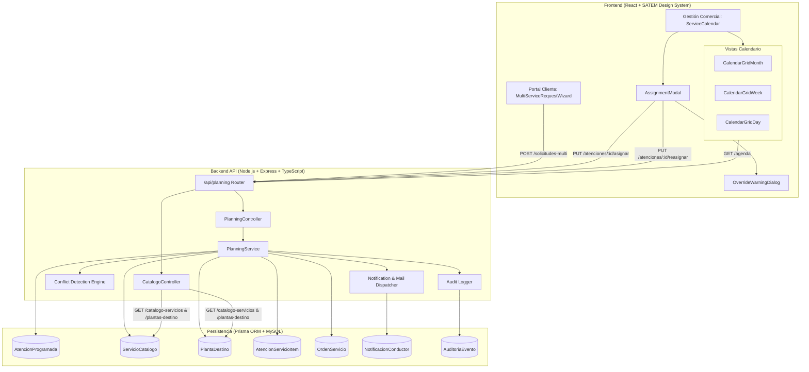
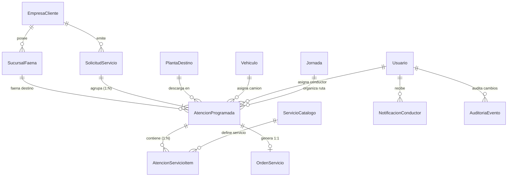
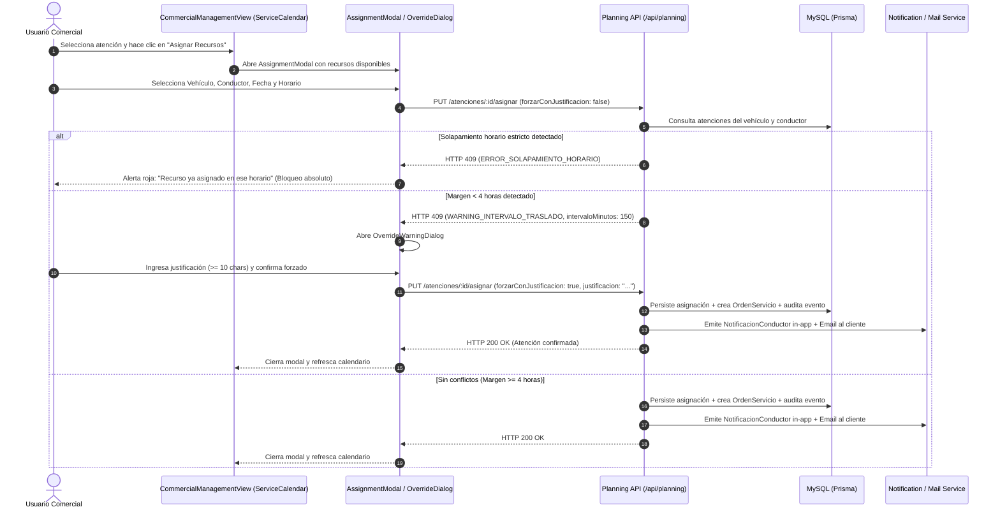

# Arquitectura Técnica: Planificación de Servicios y Agenda Operativa
## SATEM Soluciones Inteligentes — Zion Services

> **Versión**: 1.0.0  
> **Fecha de actualización**: 2026-11-23  
> **Estado**: Implementado y Operativo  
> **Módulos**: Backend (`/api/planning`), Frontend (`/commercial/calendar`, `/client/wizard`), Prisma ORM (`MySQL`)

---

## 1. Visión General del Módulo

El módulo de **Planificación de Servicios y Agenda Operativa** resuelve la coordinación integral y visual del transporte, succión y disposición de Residuos Industriales Líquidos (RILes) y lodos para faenas comerciales e industriales de Zion Services.

Permite:
1. **Desacoplar la Solicitud Comercial de las Fechas de Ejecución**: Un cliente puede solicitar múltiples retiros dentro de una misma orden o contrato mediante solicitudes multi-atención.
2. **Visualización y Gestión en Calendario Operativo**: Vistas de Mes, Semana y Día en el portal comercial para supervisión en tiempo real de la flota y los conductores.
3. **Detección Algorítmica de Conflictos**: Bloqueo estricto (*hard block*, HTTP 409) ante solapamientos de horario y advertencia preventiva (*soft warning*, HTTP 409) si el intervalo de traslado intercomunal entre faenas es inferior a 4 horas (240 minutos), habilitando forzado justificado obligatorio ($\ge 10$ caracteres).
4. **Ciclo de Vida 1:1**: Generación automática de una `OrdenServicio` y vinculación a `Jornada` al momento de confirmar una atención.
5. **Trazabilidad y Notificaciones**: Despacho automático de `NotificacionConductor` in-app, correo electrónico al cliente y persistencia inmutable en `AuditoriaEvento`.

---

## 2. Diagrama de Arquitectura de Componentes



---

## 3. Modelo de Datos Prisma (MySQL)

### 3.1 Diagrama Entidad-Relación



### 3.2 Especificación de Entidades

#### `EstadoAtencionProgramada` (Enum)
- `PENDIENTE_CONFIRMACION`: Creada por cliente o comercial, en espera de asignación de fecha/recursos.
- `PROGRAMADA`: Camión y conductor asignados; `OrdenServicio` emitida.
- `EN_CURSO`: Conductor ha iniciado la atención/jornada en terreno.
- `COMPLETADA`: Manifiesto y recepción en planta cerrados conforme.
- `CANCELADA`: Cancelada antes de su ejecución con justificación registrada.
- `REPROGRAMADA`: Fecha, bloque horario o recursos modificados.

#### `ServicioCatalogo`
Catálogo oficial de servicios prestados por la compañía:
```prisma
model ServicioCatalogo {
  id                      String                 @id @default(uuid())
  codigo                  String                 @unique // Ej: HIDROJET-ALTA, SUCCION-RILES
  nombre                  String
  descripcion             String?                @db.Text
  duracionEstimadaMinutos Int                    @default(120)
  activo                  Boolean                @default(true)
  createdAt               DateTime               @default(now())
  updatedAt               DateTime               @updatedAt

  itemsAtencion           AtencionServicioItem[]

  @@map("servicios_catalogo")
}
```

#### `PlantaDestino`
Plantas autorizadas de disposición y tratamiento de RILes y lodos:
```prisma
model PlantaDestino {
  id                  String               @id @default(uuid())
  nombre              String
  direccion           String
  comuna              String
  region              String               @default("Metropolitana")
  autorizadaRiles     Boolean              @default(true)
  resolucionSanitaria String?
  activa              Boolean              @default(true)
  createdAt           DateTime             @default(now())
  updatedAt           DateTime             @updatedAt

  atenciones          AtencionProgramada[]

  @@map("plantas_destino")
}
```

#### `AtencionProgramada`
Unidad atómica de servicio planificado en la agenda:
```prisma
model AtencionProgramada {
  id                      String                   @id @default(uuid())
  folio                   String                   @unique // Ej: AP-2026-0001
  solicitudServicioId     String
  solicitudServicio       SolicitudServicio        @relation(fields: [solicitudServicioId], references: [id])
  
  sucursalFaenaId         String
  sucursalFaena           SucursalFaena            @relation(fields: [sucursalFaenaId], references: [id])
  
  plantaDestinoId         String?
  plantaDestino           PlantaDestino?           @relation(fields: [plantaDestinoId], references: [id])
  
  fechaHoraInicio         DateTime
  fechaHoraFinEstimada    DateTime
  duracionEstimadaMinutos Int                      @default(120)
  
  estado                  EstadoAtencionProgramada @default(PENDIENTE_CONFIRMACION)
  
  vehiculoId              String?
  vehiculo                Vehiculo?                @relation(fields: [vehiculoId], references: [id])
  
  conductorId             String?
  conductor               Usuario?                 @relation("AtencionesConductor", fields: [conductorId], references: [id])
  
  ordenServicioId         String?                  @unique
  ordenServicio           OrdenServicio?           @relation(fields: [ordenServicioId], references: [id])
  
  jornadaId               String?
  jornada                 Jornada?                 @relation(fields: [jornadaId], references: [id])
  
  justificacionForzado    String?                  @db.Text
  observacionesInternas   String?                  @db.Text
  
  createdAt               DateTime                 @default(now())
  updatedAt               DateTime                 @updatedAt

  servicios               AtencionServicioItem[]

  @@index([fechaHoraInicio, fechaHoraFinEstimada])
  @@index([vehiculoId, fechaHoraInicio])
  @@index([conductorId, fechaHoraInicio])
  @@index([estado])
  @@index([solicitudServicioId])
  @@map("atenciones_programadas")
}
```

---

## 4. Reglas de Negocio y Algoritmos de Detección de Conflictos

### 4.1 Detección de Solapamiento Horario Estricto (*Hard Block*)
Se evalúa si existe coincidencia de intervalos de tiempo para el mismo vehículo o conductor:
$$\text{Conflicto} \iff (\text{start}_A < \text{end}_B) \land (\text{end}_A > \text{start}_B)$$
- **Comportamiento**: Si se detecta colisión, la API retorna inmediatamente **HTTP 409 Conflict** con código `ERROR_SOLAPAMIENTO_HORARIO`.
- **Invariante**: Ningún usuario ni rol puede forzar una colisión horaria estricta.

### 4.2 Margen de Traslado Intercomunal de 4 Horas (*Soft Warning & Forced Override*)
El margen entre atenciones consecutivas de una misma unidad/conductor debe contemplar descarga en planta de tratamiento, tiempos de ruta y retorno:
$$\text{Intervalo} = \text{start}_{\text{siguiente}} - \text{end}_{\text{previa}} < 240\text{ minutos (4 horas)}$$
- **Comportamiento**:
  1. Si `forzarConJustificacion == false`, la API retorna **HTTP 409 Conflict** con código `WARNING_INTERVALO_TRASLADO` y detalles de la atención contigua.
  2. En el frontend se abre el modal interactivo `OverrideWarningDialog.tsx`.
  3. Para proceder, el usuario comercial o administrador debe ingresar una justificación explícita de al menos 10 caracteres (`justificacion.length >= 10`).
  4. La asignación se persiste con `forzarConJustificacion: true`, almacenando la justificación en `AtencionProgramada.justificacionForzado` y en el log inmutable `AuditoriaEvento`.

### 4.3 Generación 1:1 de Orden de Servicio y Despacho a Jornada
Al confirmar/asignar una atención:
1. Se genera una `OrdenServicio` con folio correlativo (ej. `OS-2026-0001`).
2. Se vincula al `conductorId` y `vehiculoId`.
3. Se verifica si existe una `Jornada` activa en esa fecha para el camión/conductor; si no existe, se abre una nueva jornada o se asocia a la jornada vigente.

---

## 5. Diagramas de Flujo y Secuencia

### 5.1 Flujo de Asignación y Control de Tiempos en Calendario



---

## 6. Especificación de Endpoints REST

Prefijo base: `/api/planning` (protegido por middleware JWT `authenticate`).

| Método | Endpoint | Roles Permitidos | Propósito | Códigos HTTP |
|---|---|---|---|---|
| `GET` | `/agenda` | `COMERCIAL`, `ADMIN`, `JEFE_OPERACIONES`, `SUPERADMIN` | Consulta atenciones con filtros de rango de fechas, conductor, vehículo y estado. | `200`, `400`, `401`, `403` |
| `POST` | `/solicitudes-multi` | `CLIENTE`, `COMERCIAL`, `ADMIN`, `SUPERADMIN` | Registro de solicitud de servicio con múltiples atenciones programadas. | `201`, `400`, `401`, `403` |
| `PUT` | `/atenciones/:id/asignar` | `COMERCIAL`, `ADMIN`, `JEFE_OPERACIONES`, `SUPERADMIN` | Asignación de recursos (camión/conductor) y confirmación con emisión 1:1 de OS. | `200`, `400`, `404`, `409` |
| `PUT` | `/atenciones/:id/reasignar` | `COMERCIAL`, `ADMIN`, `JEFE_OPERACIONES`, `SUPERADMIN` | Reasignación de recursos o cambio de horario con notificación a conductores. | `200`, `400`, `404`, `409` |
| `GET` | `/catalogo-servicios` | Todos autenticados | Listado de servicios oficiales del catálogo con estado activo. | `200`, `401` |
| `GET` | `/plantas-destino` | Todos autenticados | Listado de plantas autorizadas de disposición y tratamiento final. | `200`, `401` |

---

## 7. Componentes Frontend y SATEM Design System

Los componentes frontend cumplen estrictamente con la guía de estilo **SATEM Design System**:
- **Tokens Dark Mode Premium**: Uso de variables CSS (`--bg-primary`, `--bg-secondary`, `--accent-primary`, etc.) sin dependencias CSS externas tipo Tailwind.
- **Vistas Modulares**:
  - `ServiceCalendar.tsx`: Contenedor principal con selector de vista (Mes, Semana, Día) y filtros de fecha y recursos.
  - `CalendarGridMonth.tsx`: Cuadrícula mensual con badges por estado y tooltip informativo.
  - `CalendarGridWeek.tsx` y `CalendarGridDay.tsx`: Distribución horaria con bloques visuales proporcionales a la duración del servicio.
  - `AssignmentModal.tsx`: Diálogo accesible para vincular conductor, camión y planta.
  - `OverrideWarningDialog.tsx`: Diálogo modal de advertencia preventiva cuando el margen de traslado es menor a 4 horas.
  - `MultiServiceRequestWizard.tsx`: Formulario por pasos (3 pasos) en el Portal de Clientes para selección de sucursal, catálogo de servicios y múltiples fechas preferentes.

---

## 8. Verificación y Testing Automatizado

La arquitectura cuenta con cobertura integral de tests unitarios, de integración y E2E:
- `backend/test/validators/planning.validator.spec.ts`: Validaciones de esquemas Zod (campos obligatorios, formato ISO-8601, justificación de forzado $\ge 10$ caracteres).
- `backend/test/services/conflict-detection.spec.ts`: Detección de solapamiento estricto y cálculo de márgenes de traslado.
- `backend/test/services/planning.service.spec.ts`: Creación multi-atención, emisión de OS 1:1, reasignación y auditoría inmutable.
- `backend/test/services/catalogo.service.spec.ts`: Filtro estricto de catálogos y plantas activas.
- `backend/tests/planning.integration.test.ts`: Validación de endpoints REST y control de acceso RBAC.
- `backend/tests/planning.e2e-flow.test.ts`: Flujo E2E completo desde la solicitud hasta el forzado con justificación y reasignación.
