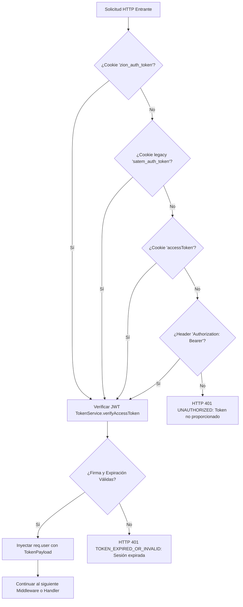

# Arquitectura Técnica: Seguridad, Autenticación y Control de Acceso (RBAC)
## Zion Services — Plataforma de Gestión Operativa y Logística de RILes

> **Versión**: 1.0.0  
> **Fecha de actualización**: 2026-11-23  
> **Estado**: Implementado, Verificado y Operativo  
> **Módulos**: Backend (`/api/auth`, `auth.middleware.ts`), Frontend (`App.tsx`, `apiFetch`), Prisma ORM (`MySQL`)

---

## 1. Visión General de Seguridad

La plataforma **Zion Services** implementa un modelo de seguridad por capas diseñado para entornos de misión crítica en logística y tratamiento de RILes. Garantiza:

1. **Gestión Segura de Sesiones**: Autenticación desacoplada basada en tokens JWT persistidos en cookies HTTP-only inmunes a ataques XSS (*Cross-Site Scripting*).
2. **Estrategia de Cookie Primaria y Fallback Dual**: Cookie oficial `zion_auth_token` con retrocompatibilidad controlada hacia `satem_auth_token` (sesiones legacy) y cabecera estándar `Authorization: Bearer <token>`.
3. **Control de Acceso Basado en Roles (RBAC)**: Matriz estricta de permisos jerárquicos entre 6 roles operacionales.
4. **Tenant Isolation Estricto**: Aislamiento a nivel de middleware y consulta de base de datos para usuarios con perfil cliente, impidiendo fugas de información entre empresas contratantes.

---

## 2. Esquema de Cookies y Estrategia de Autenticación Dual

El backend procesa y valida la identidad del usuario a través del middleware `authenticate` (`backend/src/middleware/auth.middleware.ts`), aplicando un orden de precedencia resiliente:



### 2.1 Especificaciones de las Cookies HTTP-Only

Al invocar `POST /api/auth/login` o `POST /api/auth/refresh`, el servidor emite las cookies con las directivas de seguridad recomendadas por OWASP:

| Nombre de Cookie | Función | Vida Útil (TTL) | Flags de Seguridad |
|---|---|---|---|
| **`zion_auth_token`** | **Cookie oficial de sesión** de Zion Services conteniendo el JWT Access Token. | 15 minutos | `HttpOnly; SameSite=Lax; Path=/` *(Secure en producción)* |
| **`accessToken`** | Alias auxiliar de acceso rápido para compatibilidad interna de API. | 15 minutos | `HttpOnly; SameSite=Lax; Path=/` *(Secure en producción)* |
| **`refreshToken`** | Token de refresco de larga duración para renovación silenciosa de sesión. | 7 días | `HttpOnly; SameSite=Lax; Path=/` *(Secure en producción)* |

### 2.2 Compatibilidad Transitoria Dual (`satem_auth_token`)

Durante el proceso de unificación de marca hacia Zion Services:
- `backend/src/middleware/auth.middleware.ts` reconoce la cookie histórica `satem_auth_token` como alternativa secundaria a `zion_auth_token`. Esto previene desconexiones abruptas o cierres inesperados a conductores o personal operativo en faena con sesiones iniciadas con anterioridad.
- Al ejecutar `POST /api/auth/logout`, el sistema destruye **simultáneamente** tanto `zion_auth_token` como `satem_auth_token`, junto con `accessToken` y `refreshToken`, garantizando un cierre de sesión higiénico y absoluto.

---

## 3. Endpoints del Módulo de Autenticación (`/api/auth`)

| Método | Endpoint | Acceso | Descripción |
|---|---|---|---|
| `POST` | `/api/auth/login` | Público | Valida credenciales (`email`, `password`), certifica estado de cuenta (`activo === true`) y setea cookies `zion_auth_token`, `accessToken` y `refreshToken`. |
| `POST` | `/api/auth/logout` | Público / Autenticado | Invalida y remueve las cookies `zion_auth_token`, `satem_auth_token`, `accessToken` y `refreshToken` mediante `res.clearCookie()`. |
| `GET` | `/api/auth/me` | Autenticado | Retorna el perfil y rol del usuario autenticado a partir de `req.user.userId`. |
| `POST` | `/api/auth/refresh` | Público con Refresh Token | Renueva el Access Token y resetea las cookies HTTP-only `zion_auth_token` y `accessToken`. |

---

## 4. Matriz de Control de Acceso Basado en Roles (RBAC)

El middleware `authorize(...rolesPermitidos)` evalúa en tiempo de ejecución los privilegios del usuario:

```typescript
// Regla Universal: SUPERADMIN posee autorización transversal sobre cualquier recurso
const tieneAcceso = rolesPermitidos.includes(req.user.rol) || req.user.rol === RolUsuario.SUPERADMIN;
```

| Rol | Alcance y Capacidades Operativas |
|---|---|
| **`SUPERADMIN`** | Acceso irrestricto transversal: configuración del sistema, auditoría forense, gestión global de usuarios, empresas y flota. |
| **`ADMIN`** | Administración operativa completa: gestión de flota, creación de usuarios, configuración comercial y reportes ejecutivos. |
| **`COMERCIAL`** | Gestión de clientes, recepción de solicitudes, planificación de atenciones en agenda y emisión/aprobación de cotizaciones y órdenes. |
| **`JEFE_OPERACIONES`** | Supervisión en vivo de servicios, asignación y reasignación de camiones y choferes, gestión de bitácora y control de incidencias. |
| **`CONDUCTOR`** | Acceso optimizado para tablet: recepción de jornada, checklist preoperacional, bitácora de terreno, captura de firma táctil y manifiesto de pesaje. |
| **`CLIENTE`** | Portal autoservicio aislado: solicitud multi-atención de servicios, timeline en vivo de bitácora y descarga de expedientes y certificados oficiales. |

---

## 5. Aislamiento Multitenant (Tenant Isolation)

Para usuarios con perfil `CLIENTE`, el middleware `enforceTenantIsolation` valida obligatoriamente que `targetEmpresaId === req.user.empresaClienteId`. En caso de discrepancia o intento de acceso forzado por URL o payload:
1. Se interrumpe la petición inmediatamente con código **HTTP 403 FORBIDDEN** (`TENANT_ISOLATION_VIOLATION`).
2. Se registra un log estructurado de advertencia en el subsistema de auditoría con identificación del usuario infractor y la empresa solicitada.

---

## 6. Cobertura de Pruebas Automatizadas

El mecanismo de autenticación y cookies cuenta con pruebas unitarias y de integración en `backend/src/services/auth.security.test.ts`:
- Emisión y validación de `zion_auth_token` vía cookies HTTP-only.
- Resolución de fallback dual ante cookies legacy `satem_auth_token`.
- Soporte de header `Authorization: Bearer <token>`.
- Invalidación simultánea en logout.
- Rechazo estricto ante firmas inválidas, tokens vencidos o payloads manipulados.
