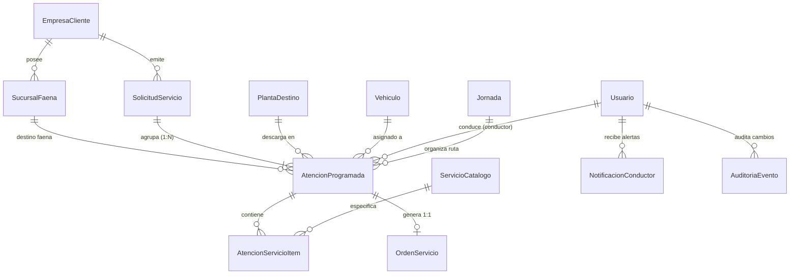
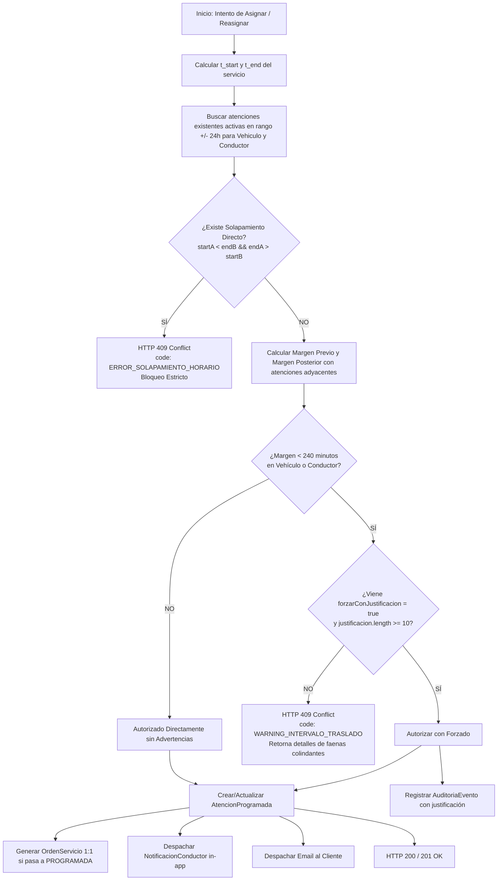

# Technical Design: Planificación Visual de Servicios y Calendario Operativo

Este documento establece la arquitectura y especificación técnica para la implementación del cambio **`service-planning-calendar`** en el ecosistema **Zion Services**, respetando los estándares de backend (Node.js, Express, Prisma ORM, MySQL, Zod) y frontend (React, TypeScript, SATEM Design System).

---

## 1. Contexto, Objetivos y Non-Goals

### 1.1 Contexto del Negocio
Zion Services gestiona servicios de transporte, retiro y disposición final de residuos industriales líquidos (RILes) y sólidos para faenas comerciales e industriales en la Región Metropolitana e interregional. La asignación operativa actual carece de una herramienta centralizada e interactiva para calendarizar atenciones en vistas temporalizadas (mes, semana y día). Esto genera ineficiencias críticas:
- Riesgos de doble asignación (solapamiento temporal de camiones o conductores).
- Falta de validación del margen mínimo para traslados intercomunales, acarreando retrasos y fatiga de conductores.
- Complejidad en clientes que requieren múltiples retiros recurrentes (por ejemplo, retiro interdiario en una misma semana) bajo una sola gestión comercial.

### 1.2 Objetivos del Cambio
1. **Calendario Operativo Multi-Vista**: Implementar un componente de calendario ligero y nativo en React bajo el **SATEM Design System** con navegación por Mes, Semana y Día en la vista de Gestión Comercial (`CommercialManagementView.tsx`), reservado para roles `COMERCIAL`, `ADMIN` y `JEFE_OPERACIONES`.
2. **Desacople de Solicitudes Multi-Atención**: Modelar la entidad `AtencionProgramada` vinculada a `SolicitudServicio` (1:N), permitiendo registrar múltiples fechas de retiro con servicios específicos del catálogo y planta de destino.
3. **Detección Algorítmica de Conflictos (Hard Block)**: Bloquear de forma estricta (HTTP 409) la persistencia de asignaciones que presenten solapamiento horario exacto en un mismo vehículo o conductor.
4. **Regla de 4 Horas Intercomunal (Soft Warning & Forced Override)**: Detectar automáticamente márgenes de traslado inferiores a 4 horas (240 minutos) entre atenciones consecutivas de una misma unidad/conductor. Exigir justificación explícita obligatoria ($\ge 10$ caracteres) para autorizar la asignación forzada.
5. **Generación 1:1 de Órdenes de Servicio y Despacho a Jornada**: Emitir una `OrdenServicio` individual por cada atención al momento de su confirmación y sincronizarla con la `Jornada` correspondiente.
6. **Notificaciones y Trazabilidad Inmutable**: Despachar alertas in-app a conductores (`NotificacionConductor`), correos automáticos al cliente y auditoría de eventos en `AuditoriaEvento`.

### 1.3 Non-Goals
- **Ruteo Automático con Algoritmos de Optimización de Flotas (VRP/TSP)**: El sistema no calculará rutas óptimas autónomamente mediante algoritmos genéticos o Google OR-Tools. La asignación es decisión del usuario asistida por validaciones de disponibilidad y ventanas de tiempo.
- **Reemplazo del Motor de Base de Datos**: No se incorporarán bases NoSQL ni servicios externos de calendarización (ej. Google Calendar API o CalDAV).
- **Modificación de los Protocolos de Telemetría GPS o Checklists**: Los modelos de telemetría y checklists de ruta preexistentes se mantienen intactos y se consumen de manera referencial.

---

## 2. Modelos Prisma y Estrategia de Migración

### 2.1 Diagrama Entidad-Relación (Nuevo Esquema)



### 2.2 Modelado Detallado en `schema.prisma`

A continuación se detalla la definición de los nuevos modelos y las extensiones requeridas en los modelos preexistentes dentro de `backend/prisma/schema.prisma`:

```prisma
// =============================================================
// ENUMS NUEVOS O AMPLIADOS
// =============================================================

enum EstadoAtencionProgramada {
  PENDIENTE_CONFIRMACION
  PROGRAMADA
  EN_CURSO
  COMPLETADA
  CANCELADA
  REPROGRAMADA
}

// =============================================================
// NUEVOS MODELOS DE PLANIFICACIÓN Y CATÁLOGOS
// =============================================================

/// Catálogo administrable de servicios estándar ofrecidos por Zion Services
model ServicioCatalogo {
  id                      String                 @id @default(uuid())
  codigo                  String                 @unique // Ej: HIDROJET-ALTA, SUCCION-RILES
  nombre                  String
  descripcion             String?                @db.Text
  duracionEstimadaMinutos Int                    @default(120)
  activo                  Boolean                @default(true)
  createdAt               DateTime               @default(now())
  updatedAt               DateTime               @updatedAt

  itemsAtencion           AtencionServicioItem[]

  @@map("servicios_catalogo")
}

/// Plantas autorizadas de disposición y tratamiento final de RILes y lodos
model PlantaDestino {
  id                 String               @id @default(uuid())
  nombre             String
  direccion          String
  comuna             String
  region             String               @default("Metropolitana")
  autorizadaRiles    Boolean              @default(true)
  resolucionSanitaria String?
  activa             Boolean              @default(true)
  createdAt          DateTime             @default(now())
  updatedAt          DateTime             @updatedAt

  atenciones         AtencionProgramada[]

  @@map("plantas_destino")
}

/// Atención individual programada en el calendario dentro de una Solicitud de Servicio
model AtencionProgramada {
  id                      String                   @id @default(uuid())
  folio                   String                   @unique // Ej: AP-2026-00001
  solicitudServicioId     String
  solicitudServicio       SolicitudServicio        @relation(fields: [solicitudServicioId], references: [id])
  
  sucursalFaenaId         String
  sucursalFaena           SucursalFaena            @relation(fields: [sucursalFaenaId], references: [id])
  
  plantaDestinoId         String?
  plantaDestino           PlantaDestino?           @relation(fields: [plantaDestinoId], references: [id])
  
  fechaHoraInicio         DateTime
  fechaHoraFinEstimada    DateTime
  duracionEstimadaMinutos Int                      @default(120)
  
  estado                  EstadoAtencionProgramada @default(PENDIENTE_CONFIRMACION)
  
  vehiculoId              String?
  vehiculo                Vehiculo?                @relation(fields: [vehiculoId], references: [id])
  
  conductorId             String?
  conductor               Usuario?                 @relation("AtencionesConductor", fields: [conductorId], references: [id])
  
  ordenServicioId         String?                  @unique
  ordenServicio           OrdenServicio?           @relation(fields: [ordenServicioId], references: [id])
  
  jornadaId               String?
  jornada                 Jornada?                 @relation(fields: [jornadaId], references: [id])
  
  justificacionForzado    String?                  @db.Text
  observacionesInternas   String?                  @db.Text
  
  createdAt               DateTime                 @default(now())
  updatedAt               DateTime                 @updatedAt

  servicios               AtencionServicioItem[]

  // Índices para acelerar búsquedas de colisiones horarias y filtros de calendario
  @@index([fechaHoraInicio, fechaHoraFinEstimada])
  @@index([vehiculoId, fechaHoraInicio])
  @@index([conductorId, fechaHoraInicio])
  @@index([estado])
  @@index([solicitudServicioId])
  @@map("atenciones_programadas")
}

/// Detalle N:M de servicios del catálogo vinculados a una atención programada
model AtencionServicioItem {
  id                   String             @id @default(uuid())
  atencionProgramadaId String
  atencionProgramada   AtencionProgramada @relation(fields: [atencionProgramadaId], references: [id], onDelete: Cascade)
  
  servicioCatalogoId   String
  servicioCatalogo     ServicioCatalogo   @relation(fields: [servicioCatalogoId], references: [id])
  
  cantidad             Int                @default(1)
  observaciones        String?            @db.Text
  createdAt            DateTime           @default(now())

  @@unique([atencionProgramadaId, servicioCatalogoId])
  @@map("atenciones_servicios_items")
}
```

### 2.3 Modificaciones en Modelos Existentes

1. **`SolicitudServicio`**:
   - Se agrega la relación 1 a N con `AtencionProgramada`:
     ```prisma
     atenciones AtencionProgramada[]
     ```
   - Para compatibilidad con flujos heredados (`expand-contract`), el campo `ordenServicio` se mantiene opcional durante el periodo de transición, pero las nuevas órdenes se relacionan directamente con `AtencionProgramada`.

2. **`Vehiculo`**:
   - Se agrega la relación inversa:
     ```prisma
     atencionesProgramadas AtencionProgramada[]
     ```

3. **`Usuario`**:
   - Se agrega la relación de conductor hacia sus atenciones:
     ```prisma
     atencionesAsignadas AtencionProgramada[] @relation("AtencionesConductor")
     ```

4. **`Jornada`**:
   - Se vincula a las atenciones programadas que componen dicha jornada:
     ```prisma
     atencionesProgramadas AtencionProgramada[]
     ```

5. **`OrdenServicio`**:
   - Se enlaza 1:1 con la atención programada que la originó:
     ```prisma
     atencionProgramada AtencionProgramada?
     ```

### 2.4 Estrategia de Migración de Base de Datos
La migración se realizará mediante Prisma Migrate (`npx prisma migrate dev --name add_service_planning_calendar`) asegurando compatibilidad con los datos existentes:
1. Crear las nuevas tablas `servicios_catalogo`, `plantas_destino`, `atenciones_programadas` y `atenciones_servicios_items`.
2. Seed inicial con los servicios base (`HIDROJET-ALTA`, `SUCCION-RILES`, `LIMPIEZA-FOSA`, `LODOS-DESHIDRATADOS`) y plantas de disposición conocidas (ej. Planta La Farfana, Planta Trebal, Armony Sustentable).
3. Script idempotente de backfill opcional: para las `SolicitudServicio` existentes con `OrdenServicio` asociada, generar una `AtencionProgramada` sintetizada con la `fechaPreferente` y vincular la orden existente, evitando datos huérfanos.

---

## 3. Validaciones con Esquemas Zod

Se crearán los esquemas Zod en `backend/src/schemas/planning.schema.ts` para blindar la entrada de datos en los endpoints.

```typescript
import { z } from 'zod';

// -------------------------------------------------------------
// 1. SOLICITUD MULTI-ATENCIÓN (Portal Clientes / Comercial)
// -------------------------------------------------------------

export const itemServicioSolicitudSchema = z.object({
  servicioCatalogoId: z.string().uuid({ message: "ID de servicio de catálogo inválido" }),
  cantidad: z.number().int().min(1, { message: "La cantidad mínima es 1" }).default(1),
  observaciones: z.string().max(500).optional()
});

export const itemAtencionSolicitudSchema = z.object({
  fechaHoraInicio: z.string().datetime({ message: "Formato ISO 8601 requerido para fechaHoraInicio" }),
  duracionEstimadaMinutos: z.number().int().min(30).max(720).default(120),
  sucursalFaenaId: z.string().uuid().optional(), // Si no viene, hereda la sucursal de la solicitud
  plantaDestinoId: z.string().uuid().optional(),
  servicios: z.array(itemServicioSolicitudSchema).min(1, { message: "Debe seleccionar al menos un servicio" })
});

export const solicitudMultiAtencionSchema = z.object({
  empresaClienteId: z.string().uuid({ message: "ID de empresa cliente inválido" }),
  sucursalFaenaId: z.string().uuid({ message: "ID de sucursal faena inválido" }),
  tipoResiduo: z.string().min(2, { message: "Debe especificar el tipo de residuo" }),
  descripcion: z.string().max(1000).optional(),
  cantidadEstimada: z.number().positive().optional(),
  unidadEstimada: z.enum(["KG", "TON", "M3", "LITROS"]).default("M3"),
  atenciones: z.array(itemAtencionSolicitudSchema).min(1, { message: "Debe ingresar al menos una fecha de atención" })
});

export type SolicitudMultiAtencionInput = z.infer<typeof solicitudMultiAtencionSchema>;

// -------------------------------------------------------------
// 2. ASIGNACIÓN OPERATIVA DE ATENCIÓN
// -------------------------------------------------------------

export const asignarAtencionSchema = z.object({
  vehiculoId: z.string().uuid({ message: "Vehículo inválido" }),
  conductorId: z.string().uuid({ message: "Conductor inválido" }),
  fechaHoraInicio: z.string().datetime({ message: "Formato ISO requerido para fechaHoraInicio" }),
  duracionEstimadaMinutos: z.number().int().min(30).max(720),
  plantaDestinoId: z.string().uuid().optional(),
  jornadaId: z.string().uuid().optional(),
  forzarConJustificacion: z.boolean().default(false),
  justificacionForzado: z.string().max(500).optional()
}).refine((data) => {
  if (data.forzarConJustificacion) {
    return !!data.justificacionForzado && data.justificacionForzado.trim().length >= 10;
  }
  return true;
}, {
  message: "La justificación es obligatoria y debe contener al menos 10 caracteres al forzar una asignación",
  path: ["justificacionForzado"]
});

export type AsignarAtencionInput = z.infer<typeof asignarAtencionSchema>;

// -------------------------------------------------------------
// 3. REASIGNACIÓN Y EDICIÓN DE ATENCIÓN PROGRAMADA
// -------------------------------------------------------------

export const reasignarAtencionSchema = z.object({
  nuevoVehiculoId: z.string().uuid().optional(),
  nuevoConductorId: z.string().uuid().optional(),
  nuevaFechaHoraInicio: z.string().datetime().optional(),
  nuevaDuracionEstimadaMinutos: z.number().int().min(30).max(720).optional(),
  nuevaPlantaDestinoId: z.string().uuid().optional(),
  motivoReasignacion: z.string().min(5, { message: "Debe especificar el motivo del cambio (mínimo 5 caracteres)" }),
  forzarConJustificacion: z.boolean().default(false),
  justificacionForzado: z.string().max(500).optional()
}).refine((data) => {
  if (data.forzarConJustificacion) {
    return !!data.justificacionForzado && data.justificacionForzado.trim().length >= 10;
  }
  return true;
}, {
  message: "La justificación de forzado debe contener al menos 10 caracteres",
  path: ["justificacionForzado"]
});

export type ReasignarAtencionInput = z.infer<typeof reasignarAtencionSchema>;

// -------------------------------------------------------------
// 4. FILTROS DE CONSULTA DE AGENDA (Query String)
// -------------------------------------------------------------

export const agendaQuerySchema = z.object({
  fechaDesde: z.string().datetime({ message: "fechaDesde debe ser formato ISO" }),
  fechaHasta: z.string().datetime({ message: "fechaHasta debe ser formato ISO" }),
  vehiculoId: z.string().uuid().optional(),
  conductorId: z.string().uuid().optional(),
  sucursalId: z.string().uuid().optional(),
  estado: z.nativeEnum(EstadoAtencionProgramada).optional(),
  vista: z.enum(["mes", "semana", "dia"]).default("mes")
});

export type AgendaQueryParams = z.infer<typeof agendaQuerySchema>;
```

---

## 4. Algoritmo de Detección de Conflictos y Regla de 4 Horas

El motor de validación se implementa en un servicio especializado (`backend/src/services/planning-conflict.service.ts`). Analiza rigurosamente la disponibilidad de recursos antes de cualquier persistencia.

### 4.1 Definición Matemática de Solapamiento Directo (Hard Conflict)

Dos intervalos cerrados-abiertos $[t_{start}^A, t_{end}^A)$ y $[t_{start}^B, t_{end}^B)$ colisionan si y solo si:

$$\text{Overlap}(A, B) \iff (t_{start}^A < t_{end}^B) \land (t_{end}^A > t_{start}^B)$$

Donde:
$$t_{end} = t_{start} + (\text{duracionEstimadaMinutos} \times 60000\text{ ms})$$

Si la condición se cumple para el mismo `vehiculoId` o el mismo `conductorId`, existe una **imposibilidad física**:
- **Acción del Backend**: Rechazo categórico inmediato con código de respuesta **`HTTP 409 Conflict`** y payload de error estructurado con código `"ERROR_SOLAPAMIENTO_HORARIO"`.
- **Regla Inquebrantable**: Esta colisión **NO es forzable** bajo ninguna condición, ni aun con justificación de usuario, para proteger la integridad del despacho en terreno.

```
       Atención Existente [-------------]
Caso 1:          Nueva [-------]            -> SOLAPAMIENTO (RECHAZO 409)
Caso 2: Nueva [-------------]               -> SOLAPAMIENTO (RECHAZO 409)
Caso 3:     Nueva [---------------------]   -> SOLAPAMIENTO (RECHAZO 409)
```

### 4.2 Regla de Traslado Intercomunal de 4 Horas (Soft Warning)

Cuando dos servicios se ejecutan consecutivamente por el mismo vehículo o conductor:
1. Se localiza la atención inmediata previa finalizada:
   $$t_{end}^{prev} \le t_{start}^{nuevo}$$
   $$\text{Margen Previo} = \frac{t_{start}^{nuevo} - t_{end}^{prev}}{60000\text{ ms}}$$
2. Se localiza la atención inmediata posterior:
   $$t_{start}^{post} \ge t_{end}^{nuevo}$$
   $$\text{Margen Posterior} = \frac{t_{start}^{post} - t_{end}^{nuevo}}{60000\text{ ms}}$$
3. Si $\min(\text{Margen Previo}, \text{Margen Posterior}) < 240\text{ minutos}$ (4 horas):
   - Se evalúa si las sucursales o plantas están en comunas distintas o requieren desplazamiento logístico intermedio.
   - Si el cliente de la API **no envió** `forzarConJustificacion: true` con su respectiva justificación válida, el servidor responde **`HTTP 409 Conflict`** con el código `"WARNING_INTERVALO_TRASLADO"` y la información de las faenas en conflicto para que el frontend presente el modal de advertencia interactivo.
   - Si el cliente **envió** `forzarConJustificacion: true` y una justificación de al menos 10 caracteres, el sistema autoriza la operación, persiste la justificación en `AtencionProgramada` y genera un registro inmutable en `AuditoriaEvento`.

### 4.3 Diagrama de Flujo del Algoritmo de Conflicto



---

## 5. Arquitectura Frontend (SATEM Design System)

Para cumplir con la directiva arquitectónica de mantener un bundle ágil, evitar incompatibilidades entre versiones y garantizar un Dark Mode Premium nativo, **se descarta el uso de FullCalendar u otras librerías pesadas externas**. El calendario se implementa como un módulo React TypeScript puro, apoyado en CSS nativo y tokens oficiales de SATEM.

### 5.1 Estructura Modular de Componentes

Los componentes residirán en `frontend/src/components/commercial/calendar/`:

```
frontend/src/components/commercial/calendar/
├── ServiceCalendar.tsx             # Componente raíz de la agenda con toolbar y selector de vista
├── CalendarToolbar.tsx             # Controles de navegación (< > Hoy), selector Mes/Semana/Día y filtros
├── CalendarGridMonth.tsx           # Cuadrícula 7x5/7x6 para vista mensual con celdas y badges
├── CalendarGridWeek.tsx            # Cuadrícula horaria de 7 columnas (07:00 - 20:00)
├── CalendarGridDay.tsx             # Vista detallada de 1 día con carriles por recurso/camión
├── AttentionCard.tsx               # Tarjeta interactiva de atención (colores por estado, popover rápido)
├── AssignmentModal.tsx             # Modal para asignar recursos (Camión, Conductor, Horario, Planta)
├── OverrideWarningDialog.tsx       # Diálogo modal de advertencia de traslado (<4h) con textarea de justificación
├── useServiceCalendar.ts           # Custom hook para gestión de fechas, filtros, queries y mutaciones
└── calendar.css                    # Estilos CSS específicos utilizando tokens de SATEM
```

En el Portal de Clientes:
```
frontend/src/components/client/
└── MultiServiceRequestWizard.tsx   # Wizard guiado de 4 pasos para solicitudes multi-atención
```

### 5.2 Custom Hook: `useServiceCalendar`

Encapsula el estado global de la agenda y la interacción con la API:

```typescript
export interface CalendarFilters {
  vehiculoId?: string;
  conductorId?: string;
  sucursalId?: string;
  estado?: EstadoAtencionProgramada;
}

export function useServiceCalendar() {
  const [currentDate, setCurrentDate] = useState<Date>(new Date());
  const [viewMode, setViewMode] = useState<'mes' | 'semana' | 'dia'>('mes');
  const [filters, setFilters] = useState<CalendarFilters>({});
  const [atenciones, setAtenciones] = useState<AtencionProgramadaDTO[]>([]);
  const [loading, setLoading] = useState<boolean>(false);
  const [selectedAtencion, setSelectedAtencion] = useState<AtencionProgramadaDTO | null>(null);
  const [isAssignmentModalOpen, setIsAssignmentModalOpen] = useState<boolean>(false);
  const [conflictWarning, setConflictWarning] = useState<ConflictWarningPayload | null>(null);

  // Calcula rango de fechas según viewMode y currentDate
  // Ejecuta fetchAgenda() con debounce ante cambio de filtros
  // Provee funciones: handleAssign, handleReassign, nextPeriod, prevPeriod, setToday
  
  return {
    currentDate,
    viewMode,
    filters,
    atenciones,
    loading,
    selectedAtencion,
    isAssignmentModalOpen,
    conflictWarning,
    setViewMode,
    setFilters,
    setSelectedAtencion,
    setIsAssignmentModalOpen,
    setConflictWarning,
    nextPeriod,
    prevPeriod,
    setToday,
    reloadAgenda
  };
}
```

### 5.3 Cumplimiento de Tokens de Diseño SATEM

El diseño visual aplicará estrictamente los tokens del sistema SATEM sin recurrir a pantallas claras:

| Elemento UI | Token / Valor SATEM | Propósito |
|:---|:---|:---|
| **Fondo Calendario** | `--bg-primary: #0f172a` | Fondo base dark mode |
| **Cabecera / Celdas** | `--bg-surface: #1e293b` | Superficie de contraste |
| **Bordes de Cuadrícula** | `--border-color: #334155` | Separadores de bajo contraste |
| **Acento Primario** | `--accent-primary: #00a896` | Botón "Hoy", vista activa, foco |
| **Texto Principal** | `--text-primary: #f8fafc` | Títulos y horas legibles |
| **Texto Secundario** | `--text-secondary: #94a3b8` | Días no pertenecientes al mes |
| **Badge PENDIENTE** | `#f59e0b` (Ámbar) | Requiere revisión comercial |
| **Badge PROGRAMADA** | `#3b82f6` (Azul) | Con recursos asignados |
| **Badge EN_CURSO** | `#10b981` (Verde Esmeralda) | Faena activa en terreno |
| **Badge CONFLICTO** | `#ef4444` (Rojo) | Solapamiento o advertencia |

### 5.4 Flujo del Wizard en Portal de Clientes (`MultiServiceRequestWizard.tsx`)

1. **Paso 1: Datos Base y Sucursal**: Selección de la sucursal de faena del cliente y tipo de residuo primario.
2. **Paso 2: Fechas y Horarios**: Permite agregar múltiples bloques de retiro (ej. Lunes 09:00, Miércoles 14:00, Viernes 09:00).
3. **Paso 3: Selección de Servicios del Catálogo**: Para cada fecha agregada, el cliente marca con checkboxes los servicios requeridos (ej. `Hidrojet Alta Presión`, `Succión de RILes`) e ingresa volumen estimado.
4. **Paso 4: Resumen y Confirmación**: Revisión del itinerario de atenciones solicitadas. Al emitir, el sistema crea la `SolicitudServicio` y todas sus `AtencionProgramada` en estado `PENDIENTE_CONFIRMACION`.

---

## 6. Contratos de API REST

Todos los endpoints se alojan bajo el prefijo `/api/planning` y requieren autenticación mediante JWT (`Bearer Token`).

### 6.1 `GET /api/planning/agenda`
Obtiene las atenciones programadas para un intervalo temporal con sus relaciones.

- **Roles Autorizados**: `COMERCIAL`, `ADMIN`, `JEFE_OPERACIONES`, `OPERACIONES`.
- **Query Parameters**:
  - `fechaDesde` (string, ISO datetime, requerido)
  - `fechaHasta` (string, ISO datetime, requerido)
  - `vehiculoId` (string, UUID, opcional)
  - `conductorId` (string, UUID, opcional)
  - `sucursalId` (string, UUID, opcional)
  - `estado` (enum `EstadoAtencionProgramada`, opcional)
- **Respuestas**:
  - **`200 OK`**:
    ```json
    {
      "success": true,
      "data": [
        {
          "id": "c1f7a28e-8e54-416e-a342-99e28f323e01",
          "folio": "AP-2026-00042",
          "solicitudServicioId": "d54f...-...",
          "cliente": {
            "id": "e43b...-...",
            "razonSocial": "Industrias Alimentos San Pedro S.A."
          },
          "sucursalFaena": {
            "id": "b11c...-...",
            "nombre": "Planta Quilicura",
            "comuna": "Quilicura",
            "direccion": "Av. Eduardo Frei Montalva 4500"
          },
          "fechaHoraInicio": "2026-11-25T09:00:00.000Z",
          "fechaHoraFinEstimada": "2026-11-25T11:00:00.000Z",
          "duracionEstimadaMinutos": 120,
          "estado": "PROGRAMADA",
          "vehiculo": {
            "id": "v77a...-...",
            "patente": "PJ-9234",
            "modelo": "Mercedes Benz Actros 2645"
          },
          "conductor": {
            "id": "u88f...-...",
            "nombre": "Carlos",
            "apellido": "Valenzuela"
          },
          "plantaDestino": {
            "id": "p12d...-...",
            "nombre": "Planta La Farfana (Aguas Andinas)"
          },
          "servicios": [
            {
              "id": "s1...-...",
              "codigo": "SUCCION-RILES",
              "nombre": "Succión de RILes e Hidrocarburos",
              "cantidad": 1
            }
          ],
          "ordenServicioId": "os-9988-...",
          "ordenServicioFolio": "OS-2026-00120"
        }
      ]
    }
    ```
  - **`400 Bad Request`**: Parámetros de consulta no conformes al esquema Zod.
  - **`401 Unauthorized` / `403 Forbidden`**: Token ausente o rol no autorizado.

---

### 6.2 `POST /api/planning/solicitudes-multi`
Registra una solicitud de servicio que agrupa múltiples atenciones programadas.

- **Roles Autorizados**: `CLIENTE`, `COMERCIAL`, `ADMIN`.
- **Request Body**: Ver `solicitudMultiAtencionSchema`.
- **Respuestas**:
  - **`201 Created`**:
    ```json
    {
      "success": true,
      "message": "Solicitud multi-atención creada exitosamente",
      "data": {
        "solicitudId": "sol-8832-...",
        "solicitudFolio": "SOL-2026-00085",
        "totalAtencionesCreadas": 3,
        "atenciones": [
          { "id": "ap-01-...", "folio": "AP-2026-00101", "fechaHoraInicio": "2026-12-01T09:00:00.000Z", "estado": "PENDIENTE_CONFIRMACION" },
          { "id": "ap-02-...", "folio": "AP-2026-00102", "fechaHoraInicio": "2026-12-03T09:00:00.000Z", "estado": "PENDIENTE_CONFIRMACION" },
          { "id": "ap-03-...", "folio": "AP-2026-00103", "fechaHoraInicio": "2026-12-05T09:00:00.000Z", "estado": "PENDIENTE_CONFIRMACION" }
        ]
      }
    }
    ```
  - **`400 Bad Request`**: Payload inválido (ej. sin atenciones o sin servicios del catálogo).

---

### 6.3 `PUT /api/planning/atenciones/:id/asignar`
Asigna recursos (vehículo, conductor, planta, horario) a una atención programada.

- **Roles Autorizados**: `COMERCIAL`, `ADMIN`, `JEFE_OPERACIONES`.
- **Request Body**: Ver `asignarAtencionSchema`.
- **Respuestas**:
  - **`200 OK`**:
    ```json
    {
      "success": true,
      "message": "Atención programada y confirmada exitosamente",
      "data": {
        "atencionId": "c1f7a28e-8e54-416e-a342-99e28f323e01",
        "estado": "PROGRAMADA",
        "ordenServicioGenerada": {
          "id": "os-9988-...",
          "folio": "OS-2026-00120"
        },
        "notificacionConductorId": "notif-3344-..."
      }
    }
    ```
  - **`409 Conflict` (Solapamiento Estricto - No Forzable)**:
    ```json
    {
      "success": false,
      "code": "ERROR_SOLAPAMIENTO_HORARIO",
      "message": "El vehículo o conductor ya tiene un servicio asignado en el rango horario especificado",
      "conflictos": [
        {
          "tipo": "VEHICULO",
          "recursoId": "v77a...-...",
          "recursoIdentificador": "PJ-9234",
          "atencionConflictoFolio": "AP-2026-00039",
          "horarioOcupado": {
            "inicio": "2026-11-25T08:30:00.000Z",
            "fin": "2026-11-25T11:30:00.000Z"
          }
        }
      ]
    }
    ```
  - **`409 Conflict` (Advertencia de Traslado < 4h - Requiere Justificación)**:
    ```json
    {
      "success": false,
      "code": "WARNING_INTERVALO_TRASLADO",
      "message": "El intervalo con la faena anterior o posterior es menor a 4 horas (240 min). Se requiere justificación explícita para forzar la asignación.",
      "detalles": {
        "margenMinutos": 120,
        "tipoRecurso": "VEHICULO",
        "recursoIdentificador": "PJ-9234",
        "faenaAnterior": {
          "folio": "AP-2026-00038",
          "comuna": "San Bernardo",
          "termino": "2026-11-25T07:00:00.000Z"
        },
        "faenaSolicitada": {
          "comuna": "Quilicura",
          "inicio": "2026-11-25T09:00:00.000Z"
        }
      }
    }
    ```

---

### 6.4 `PUT /api/planning/atenciones/:id/reasignar`
Modifica fecha, horario, camión o conductor de una atención ya agendada.

- **Roles Autorizados**: `COMERCIAL`, `ADMIN`, `JEFE_OPERACIONES`.
- **Request Body**: Ver `reasignarAtencionSchema`.
- **Efectos Secundarios**:
  - Emite `NotificacionConductor` in-app a los conductores afectados (saliente y entrante).
  - Emite correo electrónico de aviso de reprogramación al cliente.
  - Guarda registro detallado en `AuditoriaEvento`.
- **Respuestas**: `200 OK` o `409 Conflict` (según reglas de solapamiento/traslado).

---

### 6.5 `GET /api/planning/catalogo-servicios`
Devuelve el listado de servicios oficiales disponibles en el catálogo.
- **Respuestas**: `200 OK` con array de `{ id, codigo, nombre, descripcion, duracionEstimadaMinutos }`.

### 6.6 `GET /api/planning/plantas-destino`
Devuelve las plantas de descarga autorizadas activas.
- **Respuestas**: `200 OK` con array de `{ id, nombre, direccion, comuna, autorizadaRiles }`.

---

## 7. Sistema de Notificaciones y Auditoría

### 7.1 Notificaciones In-App para Conductores (`NotificacionConductor`)
Cada vez que una atención sea programada, reasignada o cancelada:
1. El backend inserta un registro en la tabla `notificaciones_conductor`:
   ```typescript
   await prisma.notificacionConductor.create({
     data: {
       conductorId: nuevoConductorId,
       tipo: "ASIGNACION_SERVICIO",
       titulo: `Nuevo servicio asignado: ${atencion.folio}`,
       mensaje: `Se le ha asignado la atención ${atencion.folio} para el día ${formatFecha(atencion.fechaHoraInicio)} en ${sucursal.nombre} (${sucursal.comuna}).`,
       leida: false,
       metadata: {
         atencionId: atencion.id,
         folio: atencion.folio,
         vehiculoPatente: vehiculo.patente,
         fechaHoraInicio: atencion.fechaHoraInicio.toISOString(),
         comuna: sucursal.comuna
       }
     }
   });
   ```
2. Si hubo reasignación con cambio de conductor, se notifica también al conductor desvinculado con `tipo: "DESASIGNACION_SERVICIO"`.

### 7.2 Notificaciones por Correo Electrónico al Cliente
A través del servicio corporativo de mailing (`backend/src/services/email.service.ts`):
- **Evento Confirmación**: Despacho de email con plantilla HTML responsive bajo la identidad SATEM (Dark Header `#0f172a`, acento verde azulado `#00a896`, tipografía limpia). Incluye: Folio de atención, fecha y bloque horario confirmado, tipo de camión asignado y contacto de la mesa de ayuda.
- **Evento Reprogramación**: Informa fecha/hora anterior vs. nueva fecha acordada y motivo comercial.
- Manejo asíncrono y resiliente: Las fallas en el envío de correos no abortan la transacción de base de datos, sino que se encolan o se registran en los logs de error del servidor.

### 7.3 Registro Inmutable en `AuditoriaEvento`
Cualquier alteración a la planificación genera un registro inmutable en `auditoria_eventos`:

```typescript
await prisma.auditoriaEvento.create({
  data: {
    usuarioId: operadorAutenticado.id,
    accion: fueForzado ? "PLANIFICACION_FORZADA_TRASLADO" : "ASIGNACION_SERVICIO",
    recurso: "AtencionProgramada",
    recursoId: atencion.id,
    detallesJson: {
      folio: atencion.folio,
      vehiculoId,
      conductorId,
      fechaHoraInicio: fechaHoraInicio.toISOString(),
      forzado: fueForzado,
      justificacionForzado: justificacionForzado || null,
      valoresPrevios: {
        vehiculoId: atencionAnterior?.vehiculoId,
        conductorId: atencionAnterior?.conductorId,
        estado: atencionAnterior?.estado
      }
    },
    ipAddress: req.ip
  }
});
```

---

## 8. Decisiones Técnicas y Rationale

### 8.1 Calendario React Nativo vs. FullCalendar
- **Decisión**: Desarrollar la cuadrícula temporal de forma nativa en React + TypeScript y CSS Grid/Flexbox puro.
- **Rationale**:
  - FullCalendar añade más de 350 KB al bundle y requiere adaptar manualmente docenas de selectores CSS complejos que colisionan con el Dark Mode estricto de SATEM.
  - La implementación nativa otorga soberanía técnica absoluta sobre el renderizado de badges, accesibilidad por teclado y control de modales de colisión sin dependencias externas susceptibles a quedar descontinuadas o exigir licencias comerciales.

### 8.2 Regla de 4 Horas: Advertencia con Forzado vs. Bloqueo Rígido
- **Decisión**: La regla de 4 horas es una advertencia que puede ser superada mediante justificación explícita obligatoria registrada en auditoría.
- **Rationale**:
  - En el radio urbano de Santiago existen faenas contiguas (ej. Maipú y Pudahuel) o situaciones de contingencia de clientes VIP donde el traslado real requiere menos de 60 minutos.
  - Un bloqueo rígido forzaría a los operadores comerciales a ingresar horarios ficticios en el sistema para sortear la restricción, adulterando la telemetría y la hoja de ruta real. La flexibilidad justificada mantiene la veracidad de los datos y la rendición de cuentas operativa.

### 8.3 Modelo `AtencionProgramada` Separado vs. Duplicación de `SolicitudServicio`
- **Decisión**: Introducir la entidad `AtencionProgramada` vinculada 1:N a `SolicitudServicio`.
- **Rationale**:
  - Un cliente contractual emite un único requerimiento administrativo o comercial que involucra extracciones programadas sucesivas (ej. retiro 3 veces por semana).
  - Duplicar solicitudes completas fragmentaría la trazabilidad del cliente, obligaría a firmar múltiples autorizaciones redundantes y distorsionaría la reportería comercial de contratos SPOT vs. recurrentes.

---

## 9. Riesgos, Mitigaciones y Plan de Rollback

### 9.1 Matriz de Riesgos y Mitigaciones

| Riesgo Técnico / Operacional | Severidad | Mitigación Arquitectónica |
|:---|:---:|:---|
| **Condición de Carrera en Asignaciones Simultáneas** (Dos operadores comerciales asignan el mismo camión al mismo segundo). | **ALTA** | Uso de transacción atómica de Prisma (`prisma.$transaction`) con nivel de aislamiento por defecto de MySQL (`REPEATABLE READ`) y re-verificación de solapamiento dentro del lock transaccional. |
| **Degradación de Performance en Renderizado Mensual** (Gran cantidad de atenciones en un mes saturando el DOM). | **MEDIA** | Filtrado estricto por ventana temporal en backend; en el frontend, la celda mensual renderiza un máximo de 3 tarjetas condensadas y un badge resumido `"+N más"` con popover interactivo. |
| **Inconsistencias Horarias por Zonas de Tiempo (Timezone)** | **MEDIA** | Todas las marcas de tiempo se serializan y almacenan en UTC (`ISO 8601`) en MySQL. La conversión a hora local chilena (`America/Santiago`, UTC-3 o UTC-4 según horario de verano) se ejecuta exclusivamente en la capa de presentación de UI mediante utilitarios estandarizados de fecha. |

### 9.2 Plan de Rollback
1. **Rollback de Base de Datos**: Las nuevas tablas no eliminan campos existentes de `solicitudes_servicio` ni `ordenes_servicio`. La reversión consiste en revertir la migración Prisma (`npx prisma migrate resolve --rolled-back add_service_planning_calendar`) y eliminar las tablas creadas sin pérdida de datos históricos.
2. **Rollback de Código**: La funcionalidad se encapsula en una nueva pestaña `'agenda'` en `CommercialManagementView.tsx`. En caso de incidencia crítica, dicha pestaña puede ser ocultada mediante feature flag o comentario en el router de navegación sin afectar la operativa de órdenes ni inspecciones de flota.
