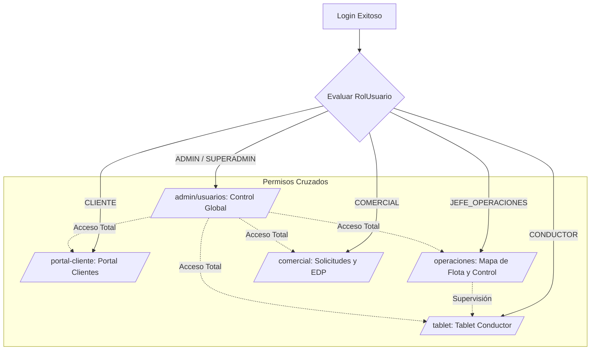

# Design: UX, RBAC & Tablet Persistence Fixes

## Context

Durante los ensayos operacionales y auditorías en terreno de Zion Services (plataforma de transporte, logística de residuos industriales y gestión de flotas SATEM), se identificaron fallas críticas que impactan la continuidad operativa, la seguridad de las identidades y la experiencia de usuario:

1. **Vulnerabilidad de pérdida de datos preoperacionales en tablet móvil**: Los conductores en faenas (tanto en patio Planta Zion como en instalaciones de clientes como Horse Chile) experimentaban reinicio del checklist preoperacional F-GMT-MAN-004 (80 ítems) y pérdida de las 4 fotos perimetrales ante recargas accidentales del navegador PWA o cierres del browser en tablets Android/iOS. Asimismo, las evidencias fotográficas se encolaban exclusivamente para envío por lote final, impidiendo que el cliente visualizara el estado y salida del camión en tiempo real.
2. **Deficiencias de autenticación y administración de identidades**:
   - La cabecera principal de la aplicación carecía de un botón explícito y claramente legible de cierre de sesión (reducido a un ícono diminuto sin texto), induciendo a errores de sesión compartida en terminales de despacho.
   - El panel de administración de usuarios (`UserManagementPanel`) ocultaba el correo electrónico como texto secundario bajo el nombre y carecía de herramientas de soporte para reseteo directo de credenciales y reasignación de roles.
   - Inconsistencia en la matriz RBAC: el rol `COMERCIAL` estaba modelado en la base de datos MySQL / Prisma pero excluido del frontend (`RolUsuario`), provocando redirecciones indebidas al panel de usuarios y falta de acceso al módulo comercial dedicado.
3. **Brechas de accesibilidad y contraste WCAG AA en Modo Claro**: El portal de clientes (`ClientPortalView`) utilizaba clases Tailwind hardcodeadas basadas en escala zinc oscura (`bg-zinc-950`, `border-zinc-800`, `text-zinc-100`, `text-zinc-400`), resultando ilegible al alternar a Light Mode debido a la falta de adopción de tokens semánticos del SATEM Design System.

Este documento de diseño establece las especificaciones de arquitectura técnica, esquemas de datos, contratos de API REST, estructuras de almacenamiento offline y componentes React para implementar una solución unificada y definitiva.

---

## Goals / Non-Goals

### Goals
- **Persistencia offline y resiliencia en terreno**: Garantizar que el checklist preoperacional (80 ítems, horómetro, kilometraje) y las 4 fotos perimetrales persistan de manera duradera en IndexedDB (`ZionFleetOfflineDB`) y fallback en `localStorage` durante toda la jornada activa, sobreviviendo a recargas de página, cierres de pestaña y caídas de red.
- **Transmisión de evidencias en tiempo real**: Implementar el envío asíncrono e inmediato de cada fotografía perimetral capturada a `POST /api/expedientes/:ordenId/documentos` con categorías oficiales `FOTO_CAMION_SALIDA` y `FOTO_CAMION_RETORNO`, con `visibleParaCliente: true` para habilitar visibilidad instantánea en el expediente del cliente.
- **Seguridad y Cierre de Sesión Seguro**: Diseñar un botón unificado y visible de "Cerrar Sesión" en la cabecera con tokens SATEM DS, con invalidación de cookie HTTP-only (`POST /api/auth/logout`), purga de estado reactivo y redirección inmediata a `/login`.
- **Panel Administrativo Integral de Usuarios**: Incorporar columna destacada de Email en la grilla y endpoints dedicados (`PATCH /api/usuarios/:id/password` y `PATCH /api/usuarios/:id/rol`) respaldados por validaciones Zod, hash SHA-256 / PBKDF2 (`CryptoUtil.hashPassword`) y componentes modales React con validación de complejidad.
- **Cumplimiento Estricto de RBAC y Módulo Comercial**: Reforzar el control de rutas por rol (`CONDUCTOR` exclusivo a `/tablet`, `CLIENTE` exclusivo a `/portal-cliente`, `JEFE_OPERACIONES` a `/operaciones` y `/tablet`, `COMERCIAL` a nueva vista `/comercial`, `ADMIN`/`SUPERADMIN` acceso completo).
- **Conformidad WCAG AA en Modo Claro y Oscuro**: Refactorizar completamente `ClientPortalView` reemplazando selectores estáticos por tokens semánticos SATEM (`bg-card`, `bg-background`, `border-border`, `text-foreground`, `text-muted-foreground`, `bg-muted`).

### Non-Goals
- Reemplazar el motor de base de datos MySQL o la capa ORM Prisma.
- Implementar un proveedor de identidad externo (IdP) o protocolo OAuth2/OIDC en esta fase (se preserva la autenticación JWT basada en cookies HTTP-only de SATEM).
- Modificar la estructura de los 80 ítems normativos del formulario F-GMT-MAN-004.
- Implementar sincronización P2P o WebSockets en tablets (se utiliza HTTP streaming y polling resiliente con sync worker).

---

## Decisions

### 1. Botón Explícito "Cerrar Sesión" en Cabecera de Navegación

#### Decisión Técnica
Se implementa en el layout unificado (`AppLayout.tsx`) un botón de logout de alta visibilidad situado en el extremo superior derecho de la barra de navegación. El botón utiliza el componente de diseño oficial de SATEM con variante `ghost`, integrando el ícono `LogOut` (16px), la etiqueta textual visible `"Cerrar Sesión"` (oculta únicamente en pantallas ultra compactas `< 480px` pero accesible vía `aria-label`) y estilo hover destructivo semántico (`hover:bg-destructive/10 hover:text-destructive`).

```tsx
// Definición en AppLayout.tsx
<Button
  variant="ghost"
  size="sm"
  onClick={handleLogout}
  className="h-8 px-2.5 text-xs font-medium text-muted-foreground hover:bg-destructive/10 hover:text-destructive transition-colors flex items-center gap-1.5"
  title="Cerrar sesión segura de SATEM"
  aria-label="Cerrar sesión"
>
  <LogOut className="h-4 w-4" />
  <span className="hidden sm:inline">Cerrar Sesión</span>
</Button>
```

Al activarse `handleLogout`:
1. Invoca el método `logout()` de `AuthContext`.
2. Emite una petición asíncrona hacia `POST /api/auth/logout` con `credentials: 'include'`.
3. El backend limpia la cookie HTTP-only `satem_auth_token` con cabeceras `Max-Age=0` y flags `Secure; HttpOnly; SameSite=Lax`.
4. El frontend remueve el token de fallback y credenciales en memoria y `localStorage` (`zion_auth_user`).
5. Se fuerza la redirección atómica hacia `/login` reemplazando el historial del navegador (`navigate('/login', { replace: true })`).

#### Justificación Técnica
En operaciones de despacho logístico y terminales compartidas, los conductores y operadores suelen abandonar el dispositivo sin advertir iconos sutiles o menus desplegables anidados. Un botón textual explícito con semántica visual destructiva previene la suplantación accidental de identidades operacionales y garantiza el cumplimiento de la política de seguridad SATEM.

#### Alternativas Consideradas
- *Menú desplegable de perfil de usuario (Avatar dropdown)*: Se descartó porque agrega un clic adicional innecesario en tablets de terreno donde los conductores utilizan guantes o pantallas resistivas.
- *Cierre de sesión puramente en cliente sin invalidación de cookie*: Se descartó debido a que deja la cookie HTTP-only activa en el navegador, permitiendo reutilización de sesión.

---

### 2. Persistencia en Tablet de Checklist y 4 Fotos Perimetrales + Envío Inmediato

#### Decisión Técnica
Se reestructura el flujo de captura preoperacional en `TabletConductorView`, `ChecklistSalidaModal` y `CameraCaptureModal` integrando una doble capa de persistencia:

```
+-----------------------------------------------------------------------------------------+
|                                    TABLET CONDUCTOR                                     |
|                                                                                         |
|  [Checklist F-GMT (80)]           [4 Fotos Perimetrales: Frontal/Trasera/Lat-Izq/Lat-Der] |
|            |                                                 |                          |
|            v                                                 v                          |
|  +-----------------------------------------------------------------------------------+  |
|  |             Capa Local Resiliente (IndexedDB: ZionFleetOfflineDB)                 |  |
|  |             - ObjectStore: 'checklists' (clave: ordenServicioId + etapa)          |  |
|  |             - ObjectStore: 'photos' (clave: ordenServicioId + slot)               |  |
|  |             - Fallback automático: localStorage (JSON stringify)                  |  |
|  +-----------------------------------------------------------------------------------+  |
|            |                                                 |                          |
|            |                                                 v Envío Inmediato          |
|            |                             POST /api/expedientes/:ordenId/documentos       |
|            |                             {                                              |
|            |                               categoria: 'FOTO_CAMION_SALIDA',             |
|            |                               nombreArchivo: 'salida_frontal.jpg',         |
|            |                               dataBase64: '...',                           |
|            |                               visibleParaCliente: true                     |
|            |                             }                                              |
|            |                                                 |                          |
|            v Envío Final                                     v                          |
|  POST /api/inspecciones/salida                   +-----------------------+              |
|                                                  | EXPEDIENTE DOCUMENTAL |              |
|                                                  |   (Visibilidad Inmediata)            |
|                                                  |   Cliente en Tiempo Real             |
+-----------------------------------------------------------------------------------------+
```

1. **Persistencia de Estado de Jornada**:
   - Cada cambio de ítem en el checklist y cada fotografía capturada se escribe reactivamente en `ZionFleetOfflineDB` (IndexedDB v2) con clave compuesta `os_${ordenId}_salida`.
   - Si la página se recarga o la tablet se reinicia por corte de batería, `TabletConductorView` y los modales consultan el store IndexedDB durante el ciclo `useEffect` inicial, restaurando el 100% de los datos y fotografías previas.
   - Si IndexedDB está bloqueado (modo incógnito estricto), se activa el fallback a `localStorage` con compresión de base64.
2. **Envío Inmediato en Tiempo Real a Expediente Documental**:
   - Al capturar cada una de las 4 fotos perimetrales (Frontal, Trasera, Lateral Izquierdo, Lateral Derecho), la imagen comprimida (JPEG `< 500 KB`) se despacha **inmediatamente** vía `POST /api/expedientes/:ordenId/documentos`.
   - Parámetros enviados:
     - `categoria`: `FOTO_CAMION_SALIDA` (o `FOTO_CAMION_RETORNO` en etapa 4).
     - `nombreArchivo`: `${ordenFolio}_FOTO_${posicion}_${Date.now()}.jpg`.
     - `mimeType`: `image/jpeg`.
     - `pesoBytes`: tamaño en bytes.
     - `visibleParaCliente`: `true`.
   - Si el dispositivo se encuentra sin señal (offline), la foto se registra en el store `syncQueue` de IndexedDB con reintentos exponenciales gestionados por `OfflineStorageService.iniciarSyncWorker()`.

#### Justificación Técnica
El despacho inmediato de fotografías desacopla la visibilidad del cliente respecto a la culminación formal del checklist de 80 preguntas. El cliente institucional puede auditar la condición del camión asignado antes de que éste abandone la planta, y el conductor no corre el riesgo de tener que volver a fotografiar el vehículo si ocurre un fallo de memoria en la tablet.

#### Alternativas Consideradas
- *Almacenar fotos únicamente en memoria React (`useState`)*: Descartado por ser la causa raíz del incidente actual de pérdida de datos.
- *Guardar imágenes solo en `localStorage`*: Descartado debido al límite de cuota estándar de 5 MB de `localStorage`, el cual se saturaría con 4 fotos de alta definición.

---

### 3. Administración Integral de Usuarios en Backend y UserManagementPanel

#### Decisión Técnica

1. **Contrato de API REST en Backend**:
   - `PATCH /api/usuarios/:id/password`:
     - Protegido por `authenticate` y `authorize(RolUsuario.SUPERADMIN, RolUsuario.ADMIN)`.
     - Validación Zod: `password` mínimo 8 caracteres, al menos una mayúscula, un número y un símbolo especial.
     - Hash con `CryptoUtil.hashPassword(password)`.
     - Actualización en MySQL vía `prisma.usuario.update()`.
   - `PATCH /api/usuarios/:id/rol`:
     - Protegido por `authenticate` y `authorize(RolUsuario.SUPERADMIN, RolUsuario.ADMIN)`.
     - Validación Zod: `rol` perteneciente a `RolUsuario`.
     - Validación condicional: Si el rol es `CLIENTE`, requiere `empresaClienteId` existente o lo valida contra el registro actual.
     - Si el rol anterior era `CONDUCTOR` y cambia a otro, se gestiona la desvinculación lógica de la ficha técnica.
2. **Interfaz de Usuario en `UserManagementPanel.tsx`**:
   - Inclusión de la columna explícita **"Email / Correo"** con tipografía monoespaciada legible, separada de la columna de nombre/RUT.
   - Creación de dos componentes modales reutilizables:
     - `ModalCambioPassword`: Formulario accesible con validación de coincidencia y medidor de seguridad, disparador de alertas SATEM y manejo de estado de carga.
     - `ModalCambioRol`: Selector interactivo de roles con advertencia dinámica de privilegios y selección obligatoria de empresa cliente cuando se asigna `CLIENTE`.
   - Feedback visual inmediato mediante notificaciones o badges de estado tras mutaciones exitosas.

```
+----------------------------------------------------------------------------------------------------+
|                                GESTIÓN DE USUARIOS (SATEM ADMIN)                                   |
+----------------------------------------------------------------------------------------------------+
| Usuario / RUT       | Email (Columna Destacada) | Rol            | Entidad       | Estado | Acción |
+---------------------+---------------------------+----------------+---------------+--------+--------+
| Carlos Sánchez      | conductor@zion.cl         | [CONDUCTOR]    | Zion Fleet    | Activo | [⚙]    |
| Horse Chile SpA     | contacto@horse.cl         | [CLIENTE]      | Horse Chile   | Activo | [⚙]    |
| Andrea Comercial    | comercial@zion.cl         | [COMERCIAL]    | Zion Ventas   | Activo | [⚙]    |
+----------------------------------------------------------------------------------------------------+
```

#### Justificación Técnica
Los administradores requerían visibilidad inmediata de las direcciones de correo para soporte en terreno y la capacidad de restablecer contraseñas de transportistas bloqueados sin recurrir a scripts de base de datos manuales.

#### Alternativas Consideradas
- *Envío de correo con link de reseteo (Magic Link)*: Aunque deseable, muchas faenas mineras o rurales tienen conectividad de correo restringida en los teléfonos corporativos de los choferes; el reseteo administrativo directo por el supervisor es mandatorio operativamente.

---

### 4. Corrección de Contraste y Adopción de SATEM Design System en ClientPortalView

#### Decisión Técnica
Se auditan y refactorizan todas las clases CSS del componente `ClientPortalView.tsx`, reemplazando valores arbitrarios de Zinc por tokens semánticos del SATEM DS definidos en `globals.css` / Tailwind:

| Clase Obsoleta (Hardcoded Zinc) | Token Semántico SATEM Design System | Utilidad y Comportamiento WCAG AA |
| :--- | :--- | :--- |
| `bg-zinc-950` | `bg-background` | Fondo primario dinámico (blanco en light, negro/zinc-950 en dark) |
| `bg-zinc-900`, `bg-zinc-900/40` | `bg-card`, `bg-muted/40` | Fondo de tarjetas y contenedores con elevación visual contrastada |
| `border-zinc-800` | `border-border` | Borde semántico adaptativo con ratio > 3:1 |
| `text-zinc-100` | `text-foreground` | Texto primario con contraste superior a 12:1 en modo claro y oscuro |
| `text-zinc-400` | `text-muted-foreground` | Texto secundario y leyendas (contraste > 4.8:1 garantizado) |
| `bg-emerald-500/10` | `bg-primary/10` o `bg-emerald-500/15` | Insignias de estado legibles sobre blanco |

Se añade además validación de legibilidad en el modal de visor de evidencias (`modalArchivo`), garantizando fondos y textos accesibles en pantallas bajo luz solar directa.

#### Justificación Técnica
Cumplir con el estándar WCAG 2.1 nivel AA (mínimo 4.5:1 para texto normal, 3:1 para componentes de UI). En modo claro, el texto `text-zinc-400` sobre fondos blancos resulta prácticamente invisible, violando la accesibilidad requerida para clientes corporativos de Zion.

#### Alternativas Consideradas
- *Forzar únicamente Dark Mode en toda la plataforma*: Descartado porque muchos clientes corporativos visualizan reportes y expedientes en oficinas iluminadas y solicitan explícitamente Light Mode.

---

### 5. Matriz RBAC Estricta y Módulo Comercial

#### Decisión Técnica

1. **Definición de Matriz RBAC**:
   - `CONDUCTOR`: Exclusivo a `/tablet`. No tiene acceso a `/portal-cliente`, `/operaciones`, `/admin/usuarios` ni `/comercial`.
   - `CLIENTE`: Exclusivo a `/portal-cliente`. Acceso con Tenant Isolation estricto (`empresaClienteId`).
   - `JEFE_OPERACIONES`: Acceso a `/operaciones` y `/tablet` (supervisión y soporte de rutas). Bloqueado a `/admin/usuarios` y `/comercial`.
   - `COMERCIAL`: Acceso a `/comercial` (gestión de solicitudes, estados de pago y emisión de órdenes). Bloqueado a despacho operativo y configuración del sistema.
   - `ADMIN` / `SUPERADMIN`: Acceso irrestricto a todos los módulos.
2. **Actualización de Enrutamiento y Navegación**:
   - En `frontend/src/types/auth.ts`: Actualización del tipo `RolUsuario = 'SUPERADMIN' | 'ADMIN' | 'JEFE_OPERACIONES' | 'OPERACIONES' | 'COMERCIAL' | 'CONDUCTOR' | 'CLIENTE'`.
   - En `frontend/src/App.tsx`:
     - Actualización de la función `getDefaultRoute()`:
       ```ts
       const getDefaultRoute = () => {
         if (!usuario) return '/login';
         if (usuario.rol === 'CLIENTE') return '/portal-cliente';
         if (usuario.rol === 'CONDUCTOR') return '/tablet';
         if (usuario.rol === 'JEFE_OPERACIONES') return '/operaciones';
         if (usuario.rol === 'COMERCIAL') return '/comercial';
         return '/admin/usuarios';
       };
       ```
     - Adición de la ruta protegida `/comercial` renderizando la vista `CommercialManagementView`.
     - Inclusión del botón de navegación `"Gestión Comercial"` en la barra de cabecera de `AppLayout` cuando `['SUPERADMIN', 'ADMIN', 'COMERCIAL'].includes(usuario.rol)`.
     - Restricción estricta en `ProtectedRoute` impidiendo fugas de navegación entre roles no autorizados.



#### Justificación Técnica
Separar de forma tajante el dominio comercial del operativo previene que un conductor acceda por URL a cotizaciones o tarifas, y que ejecutivos comerciales modifiquen checklists técnicos o autorizaciones de transporte de residuos.

#### Alternativas Consideradas
- *Permisos basados en Claims dinámicos granulares*: Para el tamaño actual de la flota y perfiles, una matriz RBAC por roles tipados es más determinista, fácil de auditar y no penaliza el rendimiento en el middleware.

---

## Risks / Trade-offs

- **[Riesgo: Almacenamiento excesivo en IndexedDB por acumulación de fotos]** -> *Mitigación*: Se aplica un ciclo de limpieza automático (`pruneOldInspections`) que elimina registros locales una vez confirmada la sincronización exitosa y transcurridas más de 48 horas de la jornada.
- **[Riesgo: Intentos simultáneos de envío de fotos en redes 3G intermitentes]** -> *Mitigación*: El cliente HTTP implementa cola FIFO con `navigator.onLine` listener y retardo de reintento exponencial, evitando sobrecargar el ancho de banda del módem de la tablet.
- **[Riesgo: Inconsistencias al cambiar el rol de un usuario activo]** -> *Mitigación*: Al modificar el rol de un usuario mediante `PATCH /api/usuarios/:id/rol`, el backend invalida inmediatamente sus sesiones activas forzando reautenticación en el próximo request.
- **[Riesgo: Confusión de usuarios al cambiar estilos de alto contraste en Light Mode]** -> *Mitigación*: Todos los tokens utilizados preservan la paleta oficial de Zion Services (esmeralda/primario, zinc neutro y acentos semánticos), conservando la identidad corporativa de la marca.

---

## Migration Plan

1. **Validación de Schema Prisma y Base de Datos**:
   - Verificar la presencia de `COMERCIAL` en el enum `RolUsuario` de `backend/prisma/schema.prisma` (ya existente en la base de datos).
   - Ejecutar `npx prisma generate` en el backend para corroborar que los tipos del cliente Prisma estén sincronizados.
2. **Despliegue Backend (Zero Downtime)**:
   - Desplegar las nuevas rutas y controladores `PATCH /api/usuarios/:id/password` y `PATCH /api/usuarios/:id/rol`.
   - Estas rutas son puramente incrementales sobre `/api/usuarios` y no rompen compatibilidad con clientes en ejecución.
3. **Despliegue Frontend**:
   - Compilación y distribución de los bundles de React actualizados con:
     - Persistencia IndexedDB en tablet.
     - Botón de cierre de sesión en cabecera.
     - Modales de gestión de contraseñas y roles.
     - Vista `/comercial` y actualización de RBAC.
     - Tokens semánticos en `ClientPortalView`.
4. **Verificación Post-Despliegue**:
   - Ejecutar pruebas automatizadas unitarias y de integración (`npm test` en backend y frontend).
   - Validar cierre de sesión y redirección en terminal móvil.
   - Probar recarga de página F5 en tablet con 40 de 80 ítems y 2 fotos capturadas, comprobando recuperación íntegra de estado.
