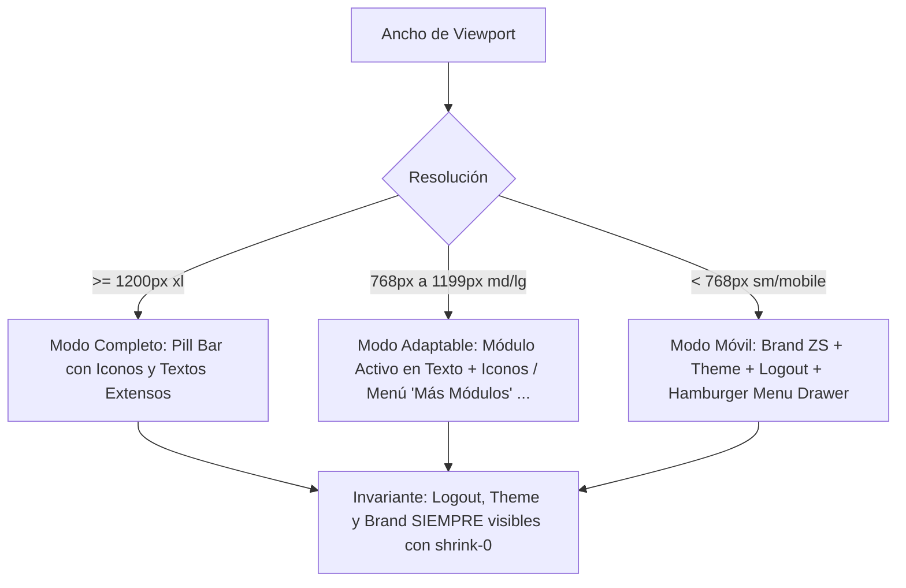

# Technical Design: Responsive UI & Theme Alignment

## Context and Architectural Goals

El sistema SATEM Zion Services opera como una plataforma web unificada para la digitalización integral de servicios de transporte, faena y pesaje. Tras la expansión funcional hacia múltiples roles (`SUPERADMIN`, `ADMIN`, `JEFE_OPERACIONES`, `COMERCIAL`, `CONDUCTOR` y `CLIENTE`), se requiere consolidar la ergonomía visual y la adaptabilidad técnica de la interfaz según los estándares del **SATEM Design System**.

Este diseño técnico resuelve de forma estructural tres desafíos de frontend:
1. **Prevención de desbordamiento horizontal y navegación responsive universal en `AppLayout` (`src/App.tsx`)**.
2. **Homogeneidad geométrica y alineación simétrica en la columna de acciones de `UserManagementPanel.tsx`**.
3. **Consistencia bicromática en el visor cartográfico de telemetría de `OperationsFleetMap.tsx`**, alineándolo con el estándar de Modo Claro y Oscuro de `ClientPortalView.tsx`.

```
                    ┌──────────────────────────────────────────────────┐
                    │               AppLayout (Header)                 │
                    │  [Brand ZS]  [Adaptable Nav]  [Pills] [Theme] [Logout]
                    └────────┬─────────────────────────────────────────┘
                             │
            ┌────────────────┴──────────────────┐
            ▼                                   ▼
┌───────────────────────────┐       ┌───────────────────────────────┐
│ UserManagementPanel (Grid)│       │  OperationsFleetMap (Map Card) │
│ - Header: w-[270px] fixed │       │ - Adaptive Canvas: light/dark │
│ - Uniform button widths   │       │ - Adaptive radial grid        │
│ - Rigid symmetric columns │       │ - Tokens: --card, --border    │
└───────────────────────────┘       └───────────────────────────────┘
```

---

## 1. Universal Responsive Navigation Architecture (`AppLayout` in `App.tsx`)

### 1.1 Problem Analysis
En la implementación actual:
- El encabezado utiliza una disposición flex rígida:
  `<header className="sticky top-0 z-40 h-16 border-b border-border bg-background/95 backdrop-blur ...">`
  `<div className="max-w-7xl mx-auto h-full px-4 flex items-center justify-between gap-4">`
- Cuando el usuario es `SUPERADMIN`, se renderizan 5 botones con textos extensos: `Tablet Conductor` (~140px), `Jefe Operaciones` (~135px), `Gestión Comercial` (~145px), `Gestión Usuarios` (~135px) y `Portal Cliente` (~120px), totalizando más de 700px sólo en el contenedor de módulos.
- Sumado a la marca ZS (~180px), la píldora de GPS (~130px), la píldora offline (~120px), el conmutador de tema (~36px) y el botón de Cerrar Sesión (~130px), la suma horizontal supera los **1300px**.
- En pantallas entre **640px y 1200px** (laptops de 1366px con zoom, tablets de 768px a 1024px o ventanas reducidas), el contenedor de la derecha desborda el viewport forzando un scroll horizontal en toda la página y dejando el botón de "Cerrar Sesión" fuera del alcance visible.
- En resoluciones móviles (< 640px), la directiva `hidden sm:flex` oculta completamente la navegación de módulos sin ofrecer un menú alternativo.

### 1.2 Multi-Tier Breakpoint Architecture
Se implementa una arquitectura responsive estructurada en tres niveles mediante flexbox resiliente, directivas `shrink-0` y un menú contextual de desborde:



#### Breakpoint Tier 1: Desktop Extendido (`>= 1200px` / `xl`)
- Muestra los 5 módulos en su barra segmentada estilizada `bg-muted rounded-lg border border-border p-1`.
- Cada botón exhibe su icono Lucide y su texto completo.
- Espacio holgado garantizado sin riesgo de desborde.

#### Breakpoint Tier 2: Pantallas Medianas & Tablets (`768px` a `1199px` / `md` a `xl`)
- Para evitar que la suma exceda el ancho disponible:
  - Los módulos principales (ej. los 2 o 3 más frecuentes según el rol o el módulo activo actual) se muestran como botones compactos con icono y texto conciso.
  - Los módulos adicionales se agrupan en un menú desplegable accesible (`DropdownMenu` / popover flotante mediante botón `<MoreHorizontal />` o selector de módulo).
  - Alternativamente, el contenedor de navegación se comprime mostrando iconos con `title` y destacando textualmente el módulo activo:
    ```tsx
    // Vista compacta para 768px - 1199px
    <div className="hidden md:flex xl:hidden items-center gap-1 p-1 bg-muted rounded-lg border border-border text-xs">
      {/* Botones con icono y etiqueta corta o solo activa */}
    </div>
    ```
- El botón de Cerrar Sesión utiliza `shrink-0` y clase `h-8 px-2.5 text-xs font-medium text-muted-foreground hover:bg-destructive/10 hover:text-destructive flex items-center gap-1.5`.

#### Breakpoint Tier 3: Dispositivos Móviles (`< 768px`)
- La cabecera expone de forma directa:
  - Izquierda: Logo ZS + Rol resumido en badge.
  - Derecha: Píldora offline (si existe), botón de tema (`h-8 w-8`), botón de logout compacto (`h-8 w-8 p-0 flex items-center justify-center`) y un botón de navegación (`Menu` / `X` de Lucide).
- Al pulsar el botón de menú, se despliega un panel inferior o drawer con estilo SATEM (`bg-card/95 backdrop-blur border-b border-border`) que lista todos los módulos disponibles con área táctil superior a 42px (estándar Touch-Friendly SATEM).

### 1.3 CSS & Flexbox Guarantees
- Contenedor de cabecera con `w-full max-w-7xl mx-auto px-4 flex items-center justify-between gap-2 overflow-hidden`.
- Botón de "Cerrar Sesión" y selector de tema con `shrink-0` obligatorio:
  `className="shrink-0 flex items-center ..."`
- `overflow-x: hidden` en el nodo raíz de `AppLayout` para impedir cualquier aparición de barras de desplazamiento horizontales en el viewport.

---

## 2. Symmetric Layout Architecture in User Actions Grid (`UserManagementPanel.tsx`)

### 2.1 Problem Analysis
En `UserManagementPanel.tsx`:
```tsx
<td className="px-4 py-3 text-right">
  <div className="flex items-center justify-end gap-1.5">
    <Button ... className="text-xs h-8 px-2">
      <KeyRound className="h-3.5 w-3.5 sm:mr-1" />
      <span className="hidden sm:inline">Clave</span>
    </Button>
    <Button ... className="text-xs h-8 px-2">
      <Shield className="h-3.5 w-3.5 sm:mr-1" />
      <span className="hidden sm:inline">Rol</span>
    </Button>
    <Button ... className={`text-xs h-8 px-2.5 ${u.activo ? ... : ...}`}>
      {u.activo ? 'Deshabilitar' : 'Habilitar'}
    </Button>
  </div>
</td>
```
- El contenedor utiliza `justify-end`.
- "Deshabilitar" mide ~98px; "Habilitar" mide ~74px (diferencia de ~24px).
- Como el layout se ancla a la derecha (`justify-end`), la variación de 24px del tercer botón empuja los botones de `Clave` y `Rol` hacia la izquierda en usuarios activos, produciendo una columna en zig-zag.
- La celda `td` y la cabecera `th` no tienen ancho fijo, por lo que el ancho total de la columna baila según las filas visibles.

### 2.2 Symmetrical Geometry & Fixed Footprints
Para resolver este problema con precisión milimétrica se implementan las siguientes restricciones geométricas:

```
┌────────────────────────────────────────────────────────────────────────┐
│                        Columna Acciones (w-[276px])                     │
├───────────────────┬───────────────────┬────────────────────────────────┤
│   Botón 'Clave'   │    Botón 'Rol'    │  Botón 'Habilitar/Deshabilitar'│
│     w-[76px]      │     w-[68px]      │           w-[114px]            │
├───────────────────┼───────────────────┼────────────────────────────────┤
│ [Key] Clave (76)  │ [Shield] Rol (68) │ [x] Deshabilitar (114)         │ (Usuario Activo)
│ [Key] Clave (76)  │ [Shield] Rol (68) │ [✓] Habilitar    (114)         │ (Usuario Inactivo)
└───────────────────┴───────────────────┴────────────────────────────────┘
  ▲                   ▲                   ▲
  Columna A           Columna B           Columna C  (Alineación vertical 100% simétrica)
```

1. **Ancho Fijo en Cabecera de Tabla**:
   `<th className="px-4 py-3 text-right w-[276px] min-w-[276px]">Acciones</th>`
2. **Dimensiones de Botones Homogéneas**:
   - Botón `Clave`: `w-[76px] h-8 justify-center shrink-0` (Icono + 'Clave').
   - Botón `Rol`: `w-[68px] h-8 justify-center shrink-0` (Icono + 'Rol').
   - Botón `Estado`: `w-[114px] h-8 justify-center shrink-0 text-center font-medium` (aloja perfectamente tanto "Deshabilitar" como "Habilitar" con padding interno constante).
3. **Contenedor con Distribución Rígida**:
   ```tsx
   <div className="flex items-center justify-end gap-1.5 w-full">
     <Button size="sm" variant="outline" className="w-[76px] h-8 px-2 justify-center shrink-0 text-xs ...">
       <KeyRound className="h-3.5 w-3.5 mr-1" />
       <span>Clave</span>
     </Button>
     <Button size="sm" variant="outline" className="w-[68px] h-8 px-2 justify-center shrink-0 text-xs ...">
       <Shield className="h-3.5 w-3.5 mr-1" />
       <span>Rol</span>
     </Button>
     <Button
       size="sm"
       variant={u.activo ? 'ghost' : 'default'}
       onClick={() => handleToggleEstado(u.id, u.activo)}
       className={`w-[114px] h-8 px-2.5 justify-center shrink-0 text-xs transition-colors ${
         u.activo
           ? 'text-destructive hover:bg-destructive/10 border border-destructive/20'
           : 'bg-emerald-600 hover:bg-emerald-500 text-white'
       }`}
     >
       {u.activo ? 'Deshabilitar' : 'Habilitar'}
     </Button>
   </div>
   ```
4. **Comportamiento en Móvil (< 640px)**:
   Si la pantalla se reduce, se provee una variante de anchos simétricos cuadrados (`w-8 h-8 p-0`) para los tres botones, manteniendo simetría total de 3 columnas de 32px.

---

## 3. Light / Dark Theme Alignment in Operations Map (`OperationsFleetMap.tsx`)

### 3.1 Problem Analysis
En `OperationsFleetMap.tsx`:
- El contenedor del mapa está codificado como:
  `<div className="relative h-80 sm:h-96 w-full bg-slate-950 flex items-center justify-center overflow-hidden">`
- La cuadrícula tiene colores fijos en la propiedad style:
  `radial-gradient(#38bdf8 1px, transparent 1px), radial-gradient(#38bdf8 1px, #020617 1px)`
- Los marcadores de Planta Zion y Faena Cliente utilizan `bg-black/70`.
- El popup del camión seleccionado utiliza `bg-black/90 border border-primary/40 text-white`.
- En `ClientPortalView.tsx`, el mapa usa:
  `bg-muted/30` y `radial-gradient(#10b981 1px, transparent 1px), radial-gradient(#10b981 1px, var(--card) 1px)`
  adaptándose inmediatamente a blanco/gris suave cuando se quita la clase `.dark`.
- La falta de adaptación en `OperationsFleetMap.tsx` quiebra la consistencia del sistema cuando el usuario opta por el Modo Claro.

### 3.2 Solution Architecture: Dynamic Semantic Tokens & Adaptive Canvas

```mermaid
stateDiagram-v2
    [*] --> DarkMode: Por defecto
    
    state DarkMode {
        Background: bg-slate-950 (#020617 / #0f172a)
        Grid: radial-gradient cian (#38bdf8) sobre fondo oscuro
        RouteLine: stroke #38bdf8 (cian brillante con resplandor)
        TruckPopup: bg-slate-900/90 border-primary/40 text-slate-100
        LocationBadges: bg-slate-900/80 text-slate-200 border-border
    }
    
    state LightMode {
        Background: bg-slate-100 / bg-muted/40 (oklch 0.97)
        Grid: radial-gradient slate-400 sobre superficie var(--card)
        RouteLine: stroke #0284c7 (azul corporativo SATEM WCAG AA)
        TruckPopup: bg-card/95 border-border text-foreground shadow-xl
        LocationBadges: bg-background/90 text-foreground border-border
    }
    
    DarkMode --> LightMode: Toggle Sol en Cabecera (.dark removido)
    LightMode --> DarkMode: Toggle Luna en Cabecera (.dark añadido)
```

### 3.3 Implementation Details

1. **Contenedor Principal Adaptable**:
   Sustituir `bg-slate-950` por clases temáticas directas o CSS variables del SATEM Design System:
   `className="relative h-80 sm:h-96 w-full bg-slate-100 dark:bg-slate-950 transition-colors duration-200 flex items-center justify-center overflow-hidden border-b border-border"`

2. **Cuadrícula Cartográfica Sensible al Tema**:
   En lugar de colores hexadecimales duros, utilizar la variable de CSS `--card` o clases dinámicas:
   ```tsx
   <div
     className="absolute inset-0 opacity-25 dark:opacity-20"
     style={{
       backgroundImage:
         'radial-gradient(var(--color-primary-marker, #0ea5e9) 1px, transparent 1px), radial-gradient(var(--color-primary-marker, #0ea5e9) 1px, var(--card) 1px)',
       backgroundSize: '28px 28px',
       backgroundPosition: '0 0, 14px 14px'
     }}
   />
   ```
   O mediante estilos semánticos que aplican un patrón limpio y técnico en modo claro y cibernético en modo oscuro.

3. **Trazo SVG de Ruta Vehicular**:
   Adaptar el color de trazo para garantizar un contraste mínimo de 4.5:1:
   ```tsx
   <svg className="absolute inset-0 h-full w-full pointer-events-none opacity-60 dark:opacity-40">
     <path
       d="M 120 320 Q 240 240, 360 180 T 560 120"
       fill="none"
       stroke="currentColor"
       className="text-primary dark:text-sky-400"
       strokeWidth="3"
       strokeDasharray="6 4"
     />
   </svg>
   ```

4. **Popovers y Marcadores Semánticos**:
   - **Planta Zion & Faena Cliente**:
     Reemplazar `bg-black/70 text-white/90` por `bg-card/90 dark:bg-black/70 text-card-foreground dark:text-white/90 border border-border shadow-md px-1.5 py-0.5 rounded text-[10px] font-bold mt-1`.
   - **Popup del Camión Seleccionado**:
     Reemplazar `bg-black/90 border border-primary/40 text-white` por `bg-card/95 dark:bg-black/90 border border-border dark:border-primary/40 text-card-foreground dark:text-white rounded-lg p-2 text-center mt-2 shadow-xl backdrop-blur-md`.
   - **Barra Flotante de Telemetría**:
     Asegurar que todas las etiquetas utilicen `text-muted-foreground` y `text-foreground` sobre `bg-card/90 border-border`, funcionando idénticamente bajo ambos modos.

---

## 4. Verification and Non-Regression Guarantees

1. **Preservación Total de RBAC y Hooks**:
   - Las rutas protegidas (`<ProtectedRoute allowedRoles={...}>`), el estado de autenticación (`useAuth()`), el tracker GPS (`useGpsTracker()`) y el worker de sincronización offline (`OfflineStorageService`) no sufren alteraciones en su lógica interna.
2. **Seguridad contra Desbordamiento (Zero Horizontal Scroll)**:
   - Verificación de viewport en 320px, 768px, 1024px, 1280px y 1920px.
   - En ninguna resolución se producirá desplazamiento horizontal en `document.body` ni en `AppLayout`.
3. **Alineación Geométrica de Acciones de Usuario**:
   - Verificación visual y mediante inspector DOM de que la coordenada horizontal `X` de los botones `Clave` y `Rol` sea exactamente idéntica entre filas de usuarios con `activo: true` y `activo: false`.
4. **Cumplimiento de Contraste WCAG 2.1 AA**:
   - Verificación de que en Modo Claro, todos los textos y datos de telemetría del mapa mantengan un ratio superior a 4.5:1 respecto a sus superficies.
